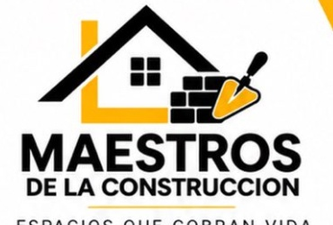

<div align="center">

  

  # Maestros de la Construcción
  ### *Artesanía Técnica, Reformas de Precisión y Trato Directo en Valencia*

  <p align="center">
    <a href="https://www.maestrosdelaconstruccion.es"></a>
    <a href="https://wa.me/34722851328"></a>
    <a href="https://vercel.com"></a>
    <a href="vercel.json"></a>
  </p>

  <p align="center">
    
    
    
    
    
  </p>

  <p align="center">
    Plataforma web de alto rendimiento para <b>Maestros de la Construcción</b> en Valencia y área metropolitana.<br />
    Diseñada con arquitectura modular, cálculo de presupuestos en tiempo real, comparador visual interactivo, asistente conversacional con IA y canal directo de captación de leads mediante WhatsApp.
  </p>

</div>

---

## Tabla de Contenidos

- [Características del Proyecto](#características-del-proyecto)
- [Stack Tecnológico](#stack-tecnológico)
- [Estructura del Repositorio](#estructura-del-repositorio)
- [Motor de Tarifas Base y Presupuestos](#motor-de-tarifas-base-y-presupuestos)
- [Seguridad y Hardening OWASP](#seguridad-y-hardening-owasp)
- [Atención al Cliente Virtual con IA](#atención-al-cliente-virtual-con-ia)
- [Despliegue y Configuración DNS](#despliegue-y-configuración-dns)
- [Posicionamiento Local y SEO](#posicionamiento-local-y-seo)
- [Canales Oficiales de Contacto](#canales-oficiales-de-contacto)

---

## Características del Proyecto

- **Simulador Interactivo de Presupuestos:** Motor matemático en cliente con rangos realistas calibrados para el mercado de Valencia por estancia (baños, cocinas, pladur, suelos, pintura, integral) y multiplicadores de calidad técnica.
- **Comparador Visual Antes / Después:** Slider interactivo con soporte táctil para comparar fases de obra real (demolición y replanteo frente a acabado porcelánico rectificado).
- **Asistente Conversacional Especializado:** Widget interactivo con motor técnico local de ordenanzas y precios de Valencia, ampliable mediante conexión con la API de Google Gemini (modelo `gemini-1.5-flash`).
- **Sistema Dual Dark / Light Mode:** Alternancia de paleta cromática arquitectónica persistente en almacenamiento local (`localStorage`).
- **Analítica Interna de Leads:** Seguimiento de interacciones hacia WhatsApp con panel administrativo discreto invocable mediante el comando de teclado `Alt + Shift + A` o triple toque en el logotipo inferior.
- **Coordinación Integral de Gremios:** Propuesta de valor orientada a pintura, reformas menores y coordinación centralizada de profesionales (climatización, carpintería, fontanería especializada).
- **Diseño Adaptativo Mobile-First:** Maquetación optimizada para smartphones, tablets y estaciones de trabajo de alta densidad.

---

## Stack Tecnológico

| Módulo | Tecnologías y Herramientas |
| :--- | :--- |
| **Frontend Core** | HTML5 semántico estructurado, JavaScript modular (ES6+, sin frameworks pesados) |
| **Diseño y Estilos** | Tailwind CSS CDN + [css/styles.css](css/styles.css) (variables CSS, micro-interacciones, tipografías técnicas) |
| **Cálculo y Lógica** | [js/calculator.js](js/calculator.js) (motor determinista con desglose de mano de obra, materiales y residuos) |
| **Inteligencia Artificial** | Google Gemini API (`gemini-1.5-flash`) con sanitización estricta + base experta local offline |
| **Infraestructura** | [Vercel](https://vercel.com/) (Edge Network, compresión Brotli/Gzip, enrutamiento limpio) |
| **Seguridad Web** | Content Security Policy (CSP), HSTS estricto, protección anti-clickjacking, sanitización anti-XSS |

---

## Estructura del Repositorio

```plaintext
Maestros_de_la_Construccion/
├── index.html                             # Página principal (Hero interactivo, especialidades, slider, simulador, footer)
├── acerca-de.html                         # Presentación del equipo de oficiales, filosofía y método sin intermediarios
├── obras.html                             # Galería de proyectos y acabados ejecutados en Valencia
├── presupuesto.html                       # Simulador técnico detallado con desglose de costes y exportación
├── donde-estamos.html                     # Mapa interactivo y comarcas de cobertura en la provincia
├── faq.html                               # Preguntas frecuentes con marcado estructurado FAQPage
├── contacto.html                          # Formulario con validación y enlace directo a WhatsApp / Correo
├── politica-de-privacidad.html            # Información legal conforme a RGPD y LOPD-GDD
├── reforma-bano-valencia.html             # Landing temática: Reformas completas de baño
├── cambiar-banera-por-ducha-valencia.html # Landing temática: Cambio de bañera a plato de ducha
├── alisar-paredes-quitar-gotele-valencia.html # Landing temática: Eliminación de gotelé y pintura sin polvo
├── pladur-techos-fosas-led-valencia.html  # Landing temática: Tabiquería pladur y candilejas LED
├── vercel.json                            # Configuración de despliegue, cabeceras de seguridad y caché
├── sitemap.xml                            # Mapa XML para indexación en Google Search Console
├── robots.txt                             # Directivas para motores de búsqueda
├── css/
│   └── styles.css                         # Hoja de estilos complementaria y variables arquitectónicas
├── js/
│   ├── main.js                            # Lógica de interfaz, slider antes/después, acordeones y tracker
│   ├── calculator.js                      # Algoritmo de tarificación y dimensionamiento de presupuestos
│   └── ai-assistant.js                    # Asistente virtual con sanitización contextual
└── img/                                   # Recursos gráficos, logotipos, favicons e imágenes de obra
```

---

## Motor de Tarifas Base y Presupuestos

El archivo [`js/calculator.js`](js/calculator.js) implementa un modelo de tarificación transparente basado en costes directos de oficial sin sobrecostes comerciales:

- **Precios Base "Desde":** Baños completos desde 1.950 € (cambio de bañera por ducha desde 590 €), cocinas desde 2.600 €, pladur técnico desde 420 €, alisado y pintura desde 450 €, solados desde 490 € y reformas integrales desde 18.500 €.
- **Escalado por Envergadura:** Presets claros de tamaño (Puntual/Aseo, Estándar habitual y Amplio/Gran formato) para evitar presupuestos volátiles o poco realistas.
- **Partidas Reales Incluidas:** Mano de obra directa cualificada, desescombro y retirada a punto limpio autorizado, visita técnica y medición gratuita en Valencia.
- **Integración con WhatsApp:** Generación de plantillas pre-rellenadas con los parámetros exactos seleccionados para formalizar presupuesto cerrado presencial.

---

## Seguridad y Hardening OWASP

El sitio implementa medidas de protección a nivel de cabeceras HTTP y sanitización de datos:

1. **Content Security Policy (CSP):**
   Definida en [`vercel.json`](vercel.json), restringe la ejecución de scripts a orígenes permitidos, bloquea objetos incrustados no autorizados (`object-src 'none'`) y limita los destinos de envío de formularios.
2. **Cabeceras HTTP Defensivas:**
   - `X-Frame-Options: DENY` (prevención de ataques de clickjacking).
   - `X-Content-Type-Options: nosniff` (bloqueo de inferencia de tipo MIME).
   - `Strict-Transport-Security: max-age=63072000; includeSubDomains; preload` (forzado HTTPS estricto).
   - `Referrer-Policy: strict-origin-when-cross-origin`.
3. **Mitigación de Reverse Tabnabbing:**
   Todos los enlaces externos con atributo `target="_blank"` cuentan de manera obligatoria con `rel="noopener noreferrer"`.
4. **Sanitización contra Inyección XSS:**
   El módulo [`js/ai-assistant.js`](js/ai-assistant.js) procesa todas las entradas de usuario y salidas de texto mediante `escapeHtml()` antes de formatear etiquetas de marcado en el DOM.

---

## Atención al Cliente Virtual con IA

Integrada en la esquina inferior derecha mediante un componente no intrusivo:
- **Modo Local:** Si no se dispone de conexión o clave API, el sistema resuelve consultas frecuentes mediante un catálogo de respuestas sobre tarifas base, plazos, normativas y zonas de atención en Valencia.
- **Modo Gemini Flash:** Permite introducir una clave personal de Google AI Studio, almacenada de forma aislada en el navegador del usuario (`localStorage`), para consultas técnicas avanzadas.

---

## Despliegue y Configuración DNS

### Configuración en Vercel
1. Conectar el repositorio de GitHub con la organización o cuenta de [Vercel](https://vercel.com).
2. Seleccionar el perfil de proyecto estático (`Build Command: none`, `Output Directory: .`).
3. Vercel aprovisionará automáticamente el certificado SSL mediante Let's Encrypt y gestionará la red perimetral Edge.

### Apuntamiento de Dominio (Hostalia)
Para vincular el dominio `maestrosdelaconstruccion.es`:
- **Registro A:** Host `@` ➔ IP `76.76.21.21`
- **Registro CNAME:** Host `www` ➔ Destino `cname.vercel-dns.com`

---

## Posicionamiento Local y SEO

- **Datos Estructurados Schema.org & GEO:**
  - `@type: HomeAndConstructionBusiness`
  - `@type: GeneralContractor`
  - `@type: FAQPage` para resultados enriquecidos (Rich Snippets).
  - Reconocimiento de Entidad por IA (`sameAs`): Enlazado canónico bidireccional entre el dominio web, Instagram (`@somosmaestrosdelaconstruccion`) y la ficha oficial de Google Maps.
- **Geolocalización Técnica:** Coordenadas de Valencia (39.4699, -0.3763).
- **Ficha de Empresa en Google Maps:** [Ver Perfil en Google](https://share.google/jS8YFrFA9vDX3dOp3)

---

## Canales Oficiales de Contacto

- **Razón Comercial:** Maestros de la Construcción
- **Ámbito:** Valencia Capital y municipios de l'Horta (Torrent, Paterna, Burjassot, Bétera, Sagunto, etc.)
- **Teléfono y WhatsApp:** [+34 722 851 328](https://wa.me/34722851328)
- **Correo Electrónico:** [contacto@maestrosdelaconstruccion.es](mailto:contacto@maestrosdelaconstruccion.es)
- **Instagram:** [@somosmaestrosdelaconstruccion](https://instagram.com/somosmaestrosdelaconstruccion)
- **Horario de Operaciones:** Lunes a Viernes de 07:00 a 17:00

---

<div align="center">
  <sub>© 2026 Maestros de la Construcción · Oficiales y Reformas en Valencia. Todos los derechos reservados.</sub>
</div>
